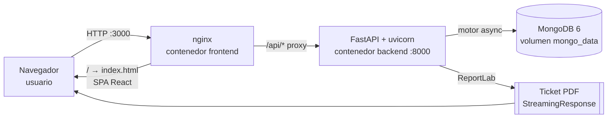
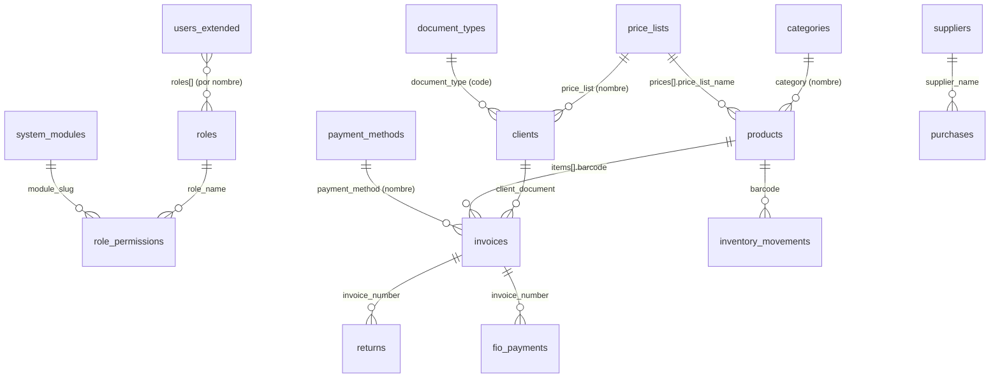
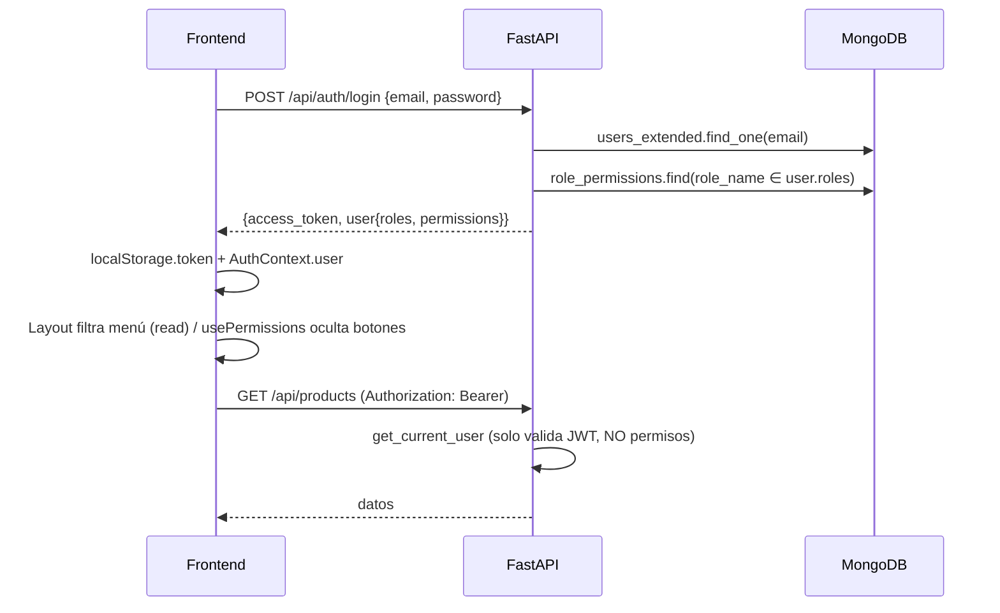

# Boltrex — Big Picture de Arquitectura (v2)

> Documento de referencia para futuras sesiones (humanas o de IA).
> Generado el 2026-11-03 tras analizar el código real de `backend/` y `frontend/`.
> **v2 (2026-11-04)**: actualizado tras completar **P0 (1–7) y P1 (8–19)** del backlog. El inventario completo de lo agregado está en **§12**.
> Cuando este documento y otros README (`README_BOLTREX.md`, `memory/PRD.md`, `.emergent/summary.txt`) se contradigan, **manda el código**; este documento se escribió leyéndolo.

---

## 1. Qué es Boltrex

Sistema de **inventario + punto de venta (POS)** para pymes (contexto Colombia: CC/NIT, IVA 19 %, Nequi/Daviplata). Módulos: Dashboard, Productos, Categorías, Listas de precios, Clientes, Proveedores, Compras, Inventario, POS, Facturas + ticket PDF, Devoluciones, Fios (créditos / cuentas por cobrar), Formas de pago, Reportes, Importación CSV/Excel, Usuarios, Roles y permisos, Config. de tickets, Factory reset.

- Nació en **Emergent** (plataforma de agentes de IA). Plantilla: `fastapi_react_mongo_shadcn_base_image`. URL de preview que usan los tests: `https://boltrex-inv.preview.emergentagent.com`.
- Idioma de la UI y del negocio: **español**. Código y nombres de campos: inglés.
- Existe un plan de evolución a **Boltrex 2.0** (Web + Android, offline-first) descrito en `Boltrex_2.0_Prompt_Maestro_Perplexity.md` — ver §11.

---

## 2. Mapa del repositorio: varios proyectos en uno

`ProyectoBoltrex-ia/` es un repo git con **dos aplicaciones desplegables independientes** más tooling compartido en la raíz:

```
ProyectoBoltrex-ia/
├── backend/                 ← PROYECTO 1: API REST (Python / FastAPI / MongoDB)
│   ├── main.py              ← app FastAPI, CORS, registro de routers bajo /api
│   ├── core/                ← config (.env), conexión Mongo (motor), seguridad JWT/bcrypt
│   ├── models/              ← Pydantic: auth, billing, entities, inventory
│   ├── routers/             ← 8 routers por dominio (ver §4.3)
│   ├── rbac.py              ← modelos RBAC + DEFAULT_MODULES + DEFAULT_ROLES
│   ├── ticket_generator.py  ← generación de tickets PDF (ReportLab) 58/80 mm
│   ├── requirements.txt
│   └── Dockerfile           ← python:3.11-slim, uvicorn :8000
│
├── frontend/                ← PROYECTO 2: SPA (React 19 / CRA + CRACO / Tailwind / shadcn)
│   ├── src/App.js           ← rutas, AuthContext, constante API
│   ├── src/components/Layout.js       ← shell + sidebar filtrado por permisos
│   ├── src/components/ui/*            ← ~45 componentes shadcn/ui (Radix)
│   ├── src/hooks/usePermissions.js    ← canRead/canCreate/canUpdate/canDelete
│   ├── src/pages/*.js       ← 20 páginas, una por módulo
│   ├── plugins/             ← plugins de Emergent (visual-edits, health-check) solo en dev
│   ├── nginx.conf           ← sirve la SPA y proxy /api → backend:8000
│   └── Dockerfile           ← build node:18 → nginx:1.25
│
├── scripts/                 ← seeding: init_rbac.py (idempotente), seed_data.py
├── tests/                   ← pytest de integración contra API remota (invoices/tickets, pagos/fios)
├── backend_test.py          ← tester HTTP manual (apunta a URL de Emergent)
├── test_reports/            ← resultados de iteraciones del "testing agent" de Emergent
├── test_result.md           ← protocolo de comunicación entre agentes de Emergent (no tocar el bloque superior)
├── split_server.py          ← script histórico: partió el antiguo backend/server.py monolítico en routers/
├── docker-compose.yml       ← mongo:6 + backend + frontend
├── design_guidelines.json   ← sistema de diseño (dark, Outfit/Manrope/JetBrains Mono)
├── memory/PRD.md            ← PRD y bitácora de sesiones (Emergent)
├── .emergent/               ← metadatos de Emergent (summary.txt = handoff del último agente)
├── README_BOLTREX.md, RBAC_GUIA_USO.md, IMPORTACION_GUIA.md
└── Boltrex_2.0_Prompt_Maestro_Perplexity.md  ← brief para auditoría/arquitectura v2
```

Historia relevante (git): el backend era un único `server.py` de >2000 líneas; en la rama `estructuracion-mejoras-proyecto` (merge `5c6606e`) se modularizó con `split_server.py` en `core/`, `models/`, `routers/`. Por eso **todos los routers comparten el mismo bloque de imports** (incluido `pandas`, `TicketPDFGenerator`, `models.* import *`) aunque no lo usen.

---

## 3. Arquitectura de sistema (runtime)



| Pieza | Tecnología | Puerto | Notas |
|---|---|---|---|
| Frontend | React 19, react-router 7, axios, Tailwind 3, shadcn/ui (Radix), lucide, sonner, cmdk | 3000 → 80 (nginx) | `REACT_APP_BACKEND_URL` vacío ⇒ usa rutas relativas `/api` (proxy nginx). En dev con CRA hay que definirla. |
| Backend | FastAPI 0.110, Pydantic 2, motor 3.3, python-jose (JWT HS256), passlib/bcrypt, pandas+openpyxl, reportlab | 8000 (solo `127.0.0.1`; desde fuera solo vía nginx :3000) | Todas las rutas bajo `/api`. OpenAPI en `/docs`. |
| BD | MongoDB 6 | 27017 (solo `127.0.0.1`) | Nombre por `DB_NAME` (default `boltrex`; en Emergent era `test_database`). |

**Despliegue**: `docker-compose up` en la raíz (contexto de build = raíz del repo, por eso los Dockerfile hacen `COPY backend/...` / `COPY frontend/...`).

⚠️ **Configuración**: `backend/.env` **no existe en el repo** (está en `.gitignore`) pero compose lo monta (`./backend/.env:/app/.env:ro`). Debe crearse con, mínimo:
```
MONGO_URL=mongodb://mongo:27017     # dentro de compose; el default 'localhost' NO funciona en el contenedor
DB_NAME=boltrex
JWT_SECRET_KEY=<secreto real>
```
Los scripts de `scripts/` exigen `MONGO_URL` y `DB_NAME` (usan `os.environ[...]`, fallan si faltan).

---

## 4. Backend en detalle

### 4.1 Capas actuales

```
main.py  →  routers/*  →  db (motor, global)   ← no hay capa de servicios ni repositorios
                ↑
          models/* (Pydantic: DTOs Create/Update + modelos de respuesta)
          core/security.get_current_user (Depends)
```

- La lógica de negocio vive **dentro de los endpoints**, apoyada en módulos de reglas de `core/` (ver §12.1). Aún no hay capa de services/repositories (P2.20).
- `core/database.py` crea un `AsyncIOMotorClient(MONGO_URL, tz_aware=True)` global; los routers usan `db` importado directamente.
- El router RBAC es una *factory* `create_rbac_router(db)`; `main.py` lo detecta con `hasattr`.
- ✅ *(P1.19)* Fechas **nativas** (`datetime` UTC, `core/dates.now_utc()`); la API las entrega con zona (`…+00:00`). Al arrancar se convierten las que queden como texto.
- Identificadores = **claves naturales** (no se exponen `_id`): `barcode`, `document_type`+`document_number` (clientes), `name`, `slug`, `email`, `invoice_number`.
- ✅ *(P1.18)* Listados que crecen **paginados en el servidor** (`core/pagination.py`, formato `{items,total,page,page_size,pages}`); catálogos pequeños sin tope (y paginados con `?paginated=true` en su pantalla).
- **Arranque** (`main.py` startup, en orden): `migrate_text_dates` → `ensure_indexes` → `flag_default_passwords` → `backfill_invoice_document_types` → `warn_products_without_price`. Ninguno impide arrancar (fallos al log).

### 4.2 Autenticación y autorización

- `POST /api/auth/login` → JWT (`sub` = email, `sid` = sesión en la colección `sessions`; máx 12 h, cierre por 1 h de inactividad desde P1.11) + `session` (tiempos) + `user` con `roles`, `permissions` (mapa `module_slug → {read,create,update,delete}`) y `must_change_password`. Además: `/auth/ping`, `/auth/logout`, `/auth/logout-all`, `/auth/change-password`.
- **Auditoría (P1.12)**: `core/audit.py` + colección `audit_log` (TTL `AUDIT_RETENTION_DAYS`=180); todos los endpoints que modifican datos y los eventos de sesión llaman `audit.record(...)` (dentro de la transacción cuando la hay). Consulta: `GET /api/audit`, `GET /api/audit/filters`, solo rol Administrador; pantalla `pages/Audit.js` (`/audit`). **Al agregar un endpoint que modifique datos, registrar su acción con `audit.record`.**
- **Fechas (P1.19)**: siempre `datetime` nativo en UTC (`core/dates.now_utc()`); el cliente Mongo es `tz_aware`. Nunca guardar fechas como texto; para leer valores antiguos usar `as_datetime`. Al arrancar, `migrate_text_dates` convierte lo que quede en texto.
- **Listados (P1.18)**: los que crecen están paginados en el servidor con `core/pagination.paginate` → `{items,total,page,page_size,pages}` (`page`, `page_size` ≤200, `search`). En el frontend: `usePaginatedList` + `<Pagination>`; nunca filtrar en el navegador sobre una lista "completa". Exportaciones: `/reports/*/export` (CSV completo).
- **Precios e IVA (P1.16/P1.17)**: `core/pricing.py` — IVA de cada producto (0–100); todo producto tiene precio 'default' y cada precio ≥ costo; un precio por lista, solo listas existentes (máximo = listas parametrizadas; en listas inactivas solo se conserva lo que ya había); en la venta: lista del cliente → 'default' (nunca un precio inventado). La colección `tax_rates` no participa en ningún cálculo.
- **Errores (mantenimiento fase 2)**: la lógica de negocio lanza `core/errors` (`BusinessError` 400, `ForbiddenError` 403, `NotFoundError` 404, `ConflictError` 409) con el mensaje en español; el manejador global responde `{"detail": mensaje}`. No usar `HTTPException` en core/ ni (desde la fase 3) en services/; sí en la capa HTTP (sesión 401, login 429, permisos).
- **Configuración (fase 2)**: `from core.config import settings` (dataclass validado); los nombres sueltos (`SECRET_KEY`, …) siguen como alias. Variable nueva ⇒ agregarla a `Settings` y a `load_settings()`.
- **Arranque (fase 2)**: `lifespan` en `main.py` → `core/startup.run_startup_tasks()`; tarea nueva ⇒ agregarla en orden a la lista de `core/startup.py` (idempotente; si falla no corta las demás).
- **Imports (fase 2)**: prohibido `from x import *`; el lint del CI se puede ampliar a F401/F403/F405/F811/F841 (hoy el código pasa).
- **Exportaciones (P2.33)**: todo reporte nuevo se exporta armando un `core/exporting.Report` y devolviendo `export_response` (Excel/PDF/CSV con encabezado de empresa y auditoría). En el frontend, `components/ExportMenu`.
- **Stock mínimo (P2.34)**: «bajo stock» siempre con `core/alerts` (`low_stock_expr`/`effective_min`: `products.min_stock` o el general de Config. Sistema), nunca con un número fijo. Pantallas que cambian stock o créditos llaman `notifyDataChanged()` para refrescar la campana.
- **Ajustes de inventario (P2.32)**: cualquier cambio de stock que no sea compra, venta o devolución va por `POST /inventory/adjustments` (deja `inventory_movements` `adjustment` con motivo). Nunca escribir `products.stock` directamente desde otro flujo.
- **Cartera (P2.30)**: toda venta a crédito guarda `due_date` (fin del día local) y `credit_term_days`, y pasa por `core/credit.check_credit_limit` dentro de la transacción. Estado/tramos se calculan al consultar (no se guardan), así nunca quedan desactualizados. Plazo y cupo del cliente solo los cambia un Administrador.
- **Caja (P2.31)**: todo dinero que entra o sale (venta de contado, abono, reembolso, ingreso/egreso) es un `cash_movements` de la caja abierta de quien lo registra (`core/cash.session_for_money` + `add_movement`, dentro de la transacción). Reembolso de devolución = máx(0, pagado − nuevo total). Nuevo flujo que mueva dinero ⇒ usar esas funciones.
- **Clientes (P1.15)**: un cliente es único por `document_type` + `document_number`; buscar siempre con `core/clients.resolve_client` (nunca solo por número). Las facturas guardan `client_document_type`. No se eliminan clientes con facturas.
- **Ventas en reportes (P1.14)**: `core/sales.py` es el único lugar para "qué cuenta como venta" (completed + partial_return + returned, total neto) y para rangos de fecha por día local (`tz_offset_minutes`). Reportes, dashboard y listados de facturas lo usan.
- **Secciones y permisos en el frontend (P1.13)**: mapa único `frontend/src/lib/access.js` (`SECTIONS`) que usan el menú (`Layout.js`), las rutas (`App.js` → `PAGES` + `RequireSection`) y el inicio (`HomeRoute`). **Al agregar una pantalla: añadirla a `SECTIONS` y a `PAGES`** (lo verifica `tests/frontend_access_check.js`). Botones: `usePermissions()` → `canCreate/canUpdate/canDelete/canAny`.
- `get_current_user` decodifica el JWT y busca en `users_extended` (fallback a colección legacy `users`).
- Permisos efectivos = **OR** de los permisos de todos los roles del usuario (`routers/rbac.get_user_permissions`).
- Roles por defecto (`rbac.py`): **Administrador** (todo), **Supervisor**, **Vendedor**. 19 módulos (`DEFAULT_MODULES`), cuyos `slug` coinciden con las rutas del frontend.
- **Autorización en backend (desde 2026-11-04)**: `core/permissions.py` define `require_permission(modulo, accion)` y `require_any_permission((m, a), ...)` como dependencias FastAPI. **Todos** los endpoints las usan (61 de negocio + 20 de `/rbac`), con el mismo permiso que exige el botón en la UI. Las lecturas que una pantalla hace de otro módulo aceptan varios permisos (p. ej. `GET /clients` acepta `clients|pos|fios:read`; `GET /products` acepta `products|pos|purchases|inventory:read`). Solo con autenticación: `GET /tax-rates` y `factory-reset` (este verifica rol `Administrador` + contraseña). Los roles con `is_active=false` no conceden permisos; un usuario desactivado es rechazado aunque su token siga vigente.
- `get_user_permissions` vive en `core/permissions.py` (se reexporta desde `routers/rbac.py`).
- Registro público `/auth/register` desactivado salvo `ALLOW_PUBLIC_REGISTRATION=true`; el frontend oculta el enlace salvo `REACT_APP_ALLOW_REGISTRATION=true`.
- Al añadir un endpoint nuevo: usar `Depends(require_permission(...))`, **nunca** `Depends(get_current_user)` a secas.
- Pruebas de regresión: `tests/security_rbac_check.py` (68 casos, ver su docstring).

### 4.3 Routers y endpoints (todos con prefijo `/api`)

| Router | Endpoints |
|---|---|
Todos exigen sesión y permiso RBAC (§4.2). **[P]** = paginado `{items,total,page,page_size,pages}` con `page`, `page_size` (≤200) y `search`.

| Router | Endpoints |
|---|---|
| `auth.py` | `POST /auth/register` (solo con `ALLOW_PUBLIC_REGISTRATION`) · `POST /auth/login` (límite de intentos, crea sesión) · `GET /auth/me` · `POST /auth/change-password` · `POST /auth/ping` · `POST /auth/logout` · `POST /auth/logout-all` |
| `products.py` | `/categories` (GET lista completa; `?paginated=true` **[P]**; POST/PUT/DELETE `/{name}`) · `/price-lists` (ídem) · `/products` **[P]** (`search`, `barcode` exacto; CRUD `/{barcode}` con reglas de precios/IVA) |
| `clients.py` | `GET/POST /document-types` · `/clients` **[P]**; GET/PUT/DELETE `/clients/{document_number}?document_type=` · `/suppliers` **[P]**, CRUD `/{name}` |
| `invoices.py` | `/tax-rates` (GET/POST, `PATCH /{name}/activate`) · `/payment-methods` (lista completa; `?paginated=true` **[P]**; CRUD), `GET /payment-methods/active` · `POST /invoices` (transacción), `GET /invoices` **[P]** (`search`, `exclude_status`, rango local), `GET /invoices/{n}` · `POST /returns`, `GET /returns` **[P]** (`invoice_number`) · Fios: `GET /fios` **[P]** (+`summary` de cartera), `GET /fios/{client_document}?document_type=`, `GET /fios/invoice/{n}`, `POST /fios/{n}/payment`, `GET /fios/payments/{n}` · `GET /pos/invoices` **[P]** (filtros; conserva `invoices`/`pagination`), `GET /pos/invoices/{n}`, `GET /pos/invoices/{n}/ticket` (PDF) |
| `inventory.py` | `POST /purchases`, `GET /purchases` **[P]** (`status`), `GET/PUT /purchases/{n}`, `POST /purchases/{n}/confirm` · `GET /inventory` **[P]** (`stock=low\|out` + `summary`), `GET /inventory/movements` **[P]** |
| `reports.py` | `GET /reports/sales` **[P]** (+`summary` neto/bruto/devoluciones del periodo) · `GET /reports/sales/export` (CSV completo) · `GET /reports/inventory` **[P]** (+`summary`) · `GET /reports/inventory/export` · `GET /dashboard/summary` (P2.29: KPIs + gráficas del periodo; vendedor = solo lo suyo) · `GET /dashboard/stats` |
| `system.py` | `POST /import/{categories\|products\|clients\|suppliers}` (CSV/XLSX, validación por fila) · `GET /import/templates/{module}` · `GET/PUT /ticket-config` · `POST /system/factory-reset` (rol Administrador + contraseña) |
| `cash.py` | `GET/PUT /cash/settings` (interruptor «exigir caja abierta») · `GET /cash/current` · `POST /cash/open` · `POST /cash/movements` · `POST /cash/sessions/{id}/close` · `GET /cash/sessions` **[P]** · `GET /cash/sessions/{id}` (P2.31) |
| `exports.py` | (incluido primero) `GET /purchases/export` · `GET /fios/statement/{doc}` · `GET /cash/sessions/{id}/export`; constructores que usan los `…/export?format=xlsx|pdf` existentes (P2.33) |
| `alerts.py` | `GET /alerts` · `POST /alerts/seen` · `GET/PUT /inventory/settings` (stock mínimo general; cambiar solo admin) (P2.34) |
| `adjustments.py` | `POST/GET /adjustment-reasons` **[P]** · `PUT/DELETE /adjustment-reasons/{name}` · `POST /inventory/adjustments` · `GET /inventory/adjustments` **[P]** · `/inventory/adjustments/export` (CSV) · `/inventory/adjustments/{n}` (P2.32) |
| `credit.py` | `GET/PUT /credit/settings` (plazo por defecto y «por vencer»; cambiar solo admin) · `GET /credit/client-status` (saldo, vencido, cupo disponible) (P2.30). La cartera en sí: `GET /fios` **[P]** (+`status`, `aging`) · `GET /fios/export` (CSV) |
| `audit.py` | `GET /audit` **[P]** y `GET /audit/filters` (solo rol Administrador) · `POST /audit/access-denied` (cualquier usuario, sobre sí mismo) |
| `rbac.py` (`/rbac`) | CRUD `/rbac/modules`, `/rbac/roles`, `/rbac/permissions` · `/rbac/users` **[P]** (sin hash) y CRUD · `POST /rbac/users/{email}/roles` · `GET /rbac/users/{email}/permissions` · `POST /rbac/users/check-permission` — con permisos y reglas anti-escalada |

### 4.4 Modelo de datos (colecciones MongoDB)



| Colección | Clave | Campos principales |
|---|---|---|
| `users_extended` | `email` | first_name, last_name, phone, is_active, `roles[]`, hashed_password |
| `users` | `email` | **legacy** (full_name, role); solo fallback en `get_current_user` |
| `roles`, `role_permissions`, `system_modules` | name / (role_name, module_slug) / slug | RBAC |
| `products` | `barcode` | name, category, purchase_price, tax_rate (%), `prices[{price_list_name, price}]`, `stock`, `min_stock` (opcional, P2.34) |
| `categories`, `price_lists`, `document_types`, `payment_methods`, `tax_rates` | name / code | catálogos |
| `clients` | `document_type` + `document_number` (único) | nombres, contacto, lat/long, `price_list`, `credit_days`/`credit_limit` (P2.30, solo admin) — buscar con `core/clients.resolve_client` |
| `suppliers` | `name` | contacto |
| `purchases` | `purchase_number` `PUR-000001` | supplier_name, items[{barcode, quantity, unit_cost, total}], status `borrador`→`confirmado` |
| `invoices` | `invoice_number` `INV-000001` | client_document, **client_document_type**, client_name, items[... + **unit_cost** (P2.29)], subtotal, total_tax, total (**neto** tras devoluciones), `status` (`completed`/`partial_return`/`returned`), `payment_status` (`pagado`/`por_cobrar`), payment_method, amount_paid, balance, `due_date`/`credit_term_days` (crédito, P2.30) |
| `counters` | `_id` (`invoice_id`, `purchase_id`) | `seq` — consecutivos atómicos (`core/counters.py`) |
| `sessions` *(P1.11)* | `_id` = sid (va en el JWT) | email, created_at, last_activity, expires_at (TTL), ip, user_agent |
| `login_attempts` *(P1.9)* | `email:<x>` / `ip:<x>` | failures, first_failure_at, locked_until, expires_at (TTL) |
| `cash_sessions` *(P2.31)* | `session_id` `CAJ-000001` | cashier_email, status open/closed, `open_key` (único: una abierta por cajero), opening_amount, closing_summary, counted_cash, denominations, difference, closing_notes, reconciled, forced_close |
| `cash_movements` *(P2.31)* | — | session_id (None = pendiente), kind (sale/fio_payment/refund/income/expense), direction in/out, method, amount, reference/reason, created_by |
| `inventory_adjustments` *(P2.32)* | `adjustment_number` `AJU-000001` | kind (entrada/salida/conteo), reason, notes, items[barcode, product_name, stock_before, counted, quantity ±, stock_after, unit_cost, value], loss_value, gain_value, total_value, created_by — nunca se edita ni borra |
| `adjustment_reasons` *(P2.32)* | `name` | description, applies_to, requires_note, is_active |
| `alerts_seen` *(P2.34)* | `email` | keys (alertas vistas, podadas a las vigentes) |
| `system_settings` *(P2.31)* | `_id: "cash"` · `_id: "credit"` *(P2.30)* | require_open_session · default_term_days, due_soon_days |
| `audit_log` *(P1.12)* | — | at (TTL `AUDIT_RETENTION_DAYS`), actor_email, ip, user_agent, browser, device, session_id, module/action (+labels), entity_id/name, summary, success, changes[], before, after, details |
| `returns` | — | invoice_number, items[], total |
| `fio_payments` | `payment_id` `PAY-XXXXXXXX` | invoice_number, amount, payment_method, notes |
| `inventory_movements` | — | barcode, movement_type (`purchase`/`sale`/`return`), quantity (±), reference |
| `ticket_config` | singleton | company_name, nit, phone, email, address, ticket_width (58/80), footer_message |

✅ *(2026-11-04)* Índices declarados en `backend/core/indexes.py` (16 únicos + 13 de rendimiento), creados al arrancar. Un duplicado rechazado por la base devuelve 400 con mensaje en español (handler de `DuplicateKeyError` en `main.py`). Toda colección nueva con clave natural debe declarar ahí su índice y su mensaje.
"Fios" **no tiene colección propia**: se deriva por agregación de `invoices` con `payment_status=por_cobrar` y `balance>0`.

### 4.5 Flujos de negocio clave

**Venta POS** (`POST /invoices`)
1. Valida `payment_status` ∈ {`pagado`, `por_cobrar`}; si `pagado`, exige forma de pago activa.
2. Busca cliente por `document_number`; toma su `price_list`.
3. Por item, **recalcula en servidor**: precio = precio de la lista del cliente en `product.prices`, o `purchase_price × 1.3` como fallback; IVA = `product.tax_rate` (no usa `tax_rates`). Valida stock.
4. Consecutivo con `counters` (`find_one_and_update $inc`).
5. Inserta factura (`pagado` ⇒ amount_paid=total, balance=0; `por_cobrar` ⇒ amount_paid=0, balance=total).
6. Por item: `$inc stock -qty` + movimiento `sale`. **Sin transacción**.

**Compra**: se crea en `borrador` (editable) → `confirm` suma stock y crea movimientos `purchase`.

**Devolución** (`POST /returns`): guarda devolución, recalcula `total` de la factura (`partial_return` / `returned`), y si era `por_cobrar` ajusta `balance` (y pasa a `pagado` si llega a 0); suma stock + movimiento `return`. Los importes y cantidades vienen **del cliente** (no se validan contra la factura original).

**Abono Fio** (`POST /fios/{n}/payment`): valida monto ≤ saldo y forma de pago activa; inserta en `fio_payments`; actualiza amount_paid/balance; si saldo ≤ 0 → `pagado`.

**Ticket PDF**: `TicketPDFGenerator` (ReportLab canvas, alto dinámico, ancho 58/80 mm) con cabecera de `ticket_config`, items, devoluciones en negativo, totales y pie.

**Factory reset**: admin + contraseña → borra 13 colecciones de datos, usuarios salvo `admin@boltrex.com`, RBAC; re-siembra RBAC y catálogos por defecto.

---

## 5. Frontend en detalle

### 5.1 Estructura y patrones

- **CRA + CRACO**, alias `@` → `src/`. JavaScript (sin TypeScript). shadcn estilo `new-york`.
- **Estado global** mínimo: `AuthContext` en `App.js` (`user`, `login`, `logout`). Token en `localStorage('token')` y en `axios.defaults.headers.common.Authorization`.
- **Sin capa de servicios/API client**: cada página llama `axios.get(\`${API}/...\`)` directamente; `API` se exporta desde `App.js`.
- Sin react-query/redux; cada página maneja su estado local con `useState`/`useEffect`. Formularios en estado manual (react-hook-form y zod están instalados pero prácticamente sin usar).
- Notificaciones con `sonner` (`toast`). Descargas (ticket PDF, plantillas) con `responseType: 'blob'`.
- Diseño: tema oscuro, Outfit (títulos), Manrope (texto), JetBrains Mono (precios/códigos) — ver `design_guidelines.json`. Muchos elementos con `data-testid` (usados por el testing agent de Emergent).

### 5.2 Rutas (todas dentro de `<ProtectedRoute><Layout/></ProtectedRoute>`)

| Ruta | Página | `moduleSlug` (sidebar) | Endpoints principales |
|---|---|---|---|
| `/login` | Login | — | `/auth/login`, `/auth/register` |
| `/` | Dashboard | dashboard | `/dashboard/stats` |
| `/products` | Products | products | `/products`, `/categories`, `/price-lists` |
| `/categories` | Categories | categories | `/categories` |
| `/clients` | Clients | clients | `/clients`, `/document-types`, `/price-lists` |
| `/suppliers` | Suppliers | suppliers | `/suppliers` |
| `/purchases` | Purchases | purchases | `/purchases`, `/suppliers`, `/products` (autocomplete cmdk) |
| `/returns` | Returns | returns | `/returns`, `/invoices` |
| `/pos` | POS | pos | `/clients`, `/products`, `/payment-methods/active`, `POST /invoices`, ticket |
| `/invoices` | Invoices | invoices | `/pos/invoices`, `/invoices/{n}`, ticket |
| `/fios` | Fios | fios | `/fios`, `/fios/{doc}`, `/fios/{n}/payment` |
| `/inventory` | Inventory | inventory | `/inventory`, `/inventory/movements` |
| `/reports` | Reports | reports | `/reports/sales`, `/reports/inventory` (export CSV en cliente) |
| `/import` | Import | import | `/import/{modulo}`, `/import/templates/{modulo}` |
| `/payment-methods` | PaymentMethods | payment-methods | `/payment-methods` |
| `/price-lists` | PriceLists | price-lists | `/price-lists` |
| `/users` | UsersManagement | users | `/rbac/users`, `/rbac/roles` |
| `/roles` | RolesPermissions | permissions | `/rbac/roles`, `/rbac/modules`, `/rbac/permissions` |
| `/ticket-config` | TicketConfig | ticket-config | `/ticket-config` |
| `/settings` | FactoryReset | permissions | `/system/factory-reset` |

### 5.3 Permisos en UI

- `Layout.js` oculta del sidebar los módulos sin `read`.
- `usePermissions()` (lee `user.permissions` del contexto) se usa en 14 páginas para ocultar/deshabilitar botones Crear/Editar/Eliminar.
- **No se usa** en Dashboard, Inventory, Invoices, Reports, FactoryReset, Login. Las rutas **no** están protegidas por permiso: cualquiera autenticado puede navegar por URL a cualquier página.
- Los permisos se obtienen en el login y se guardan solo en memoria; al recargar, se vuelven a pedir vía `/auth/me` (ver bug §8.1).

---

## 6. RBAC de punta a punta



~~Conclusión: la autorización efectiva vive solo en el frontend~~ → **Corregido 2026-11-04**: tras `get_current_user`, cada endpoint ejecuta `require_permission` contra `role_permissions` y responde **403** si falta el permiso. El frontend sigue ocultando botones/menú, pero ya no es la única barrera.

---

## 7. Seeding, credenciales y testing

- `scripts/init_rbac.py`: idempotente; crea módulos, roles y permisos faltantes.
- `scripts/seed_data.py`: crea admin + catálogos (categorías, tipos de documento, listas `default/mayorista/minorista`, IVA 19 %, formas de pago).
- Credenciales admin: `admin@boltrex.com` con la contraseña de `ADMIN_INITIAL_PASSWORD` (desde 2026-11-04 ya no hay `admin123`; cambio obligatorio al primer ingreso, ver P1.10 del backlog).
- Orden de arranque en BD nueva: levantar Mongo → `python scripts/init_rbac.py` → `python scripts/seed_data.py` (desde la raíz, con `backend/.env`).
- Las fechas se guardan nativas y la contraseña del admin sale de `ADMIN_INITIAL_PASSWORD` (sin ella los scripts se detienen).
- **Pruebas** (P0–P1): 18 baterías `tests/*_check.py` (569 comprobaciones) de **integración HTTP** contra un backend de prueba en `:8001` con BD temporal `boltrex_<x>test`, más `tests/frontend_access_check.js` (node). Cómo correrlas: ver **LEVANTAR_PROYECTO.md §6** y §12.4. Los `tests/test_*.py` antiguos de Emergent no se mantienen. Sin CI todavía (P2.24).

---

## 8. Deuda técnica y riesgos conocidos (verificados en código)

### 8.1 Bugs concretos
1. ✅ *(Corregido 2026-11-03)* `GET /auth/me` importaba el módulo inexistente `server_rbac`; al recargar la página se perdía la sesión.
2. ✅ *(Corregido 2026-11-04)* Factory reset: ahora limpia `fio_payments` y `counters`, y conserva a `admin@boltrex.com` **y** a quien lo ejecuta (antes podía dejar el sistema sin usuarios).
3. ✅ *(2026-11-03)* `docker-compose` define `MONGO_URL=mongodb://mongo:27017/?replicaSet=rs0` para el backend.
4. ✅ *(P1.14)* Reportes y dashboard incluyen devoluciones parciales (ventas netas, `core/sales.py`).
5. ✅ *(P0.3)* Devoluciones validadas contra la factura y con IVA recalculado.
6. ✅ *(P0.6)* Renombrar lista de precios / proveedor / categoría actualiza las referencias; borrar en uso se bloquea.
7. ✅ *(P1.15)* Clientes por tipo + número; no se borran clientes con facturas.
8. ⏸️ *(P1.40, decisión de negocio pendiente)* Excedente a favor del cliente cuando lo abonado supera el total tras una devolución.

### 8.2 Seguridad
Corregido el 2026-11-04:
- ✅ `/api/rbac/*` exige autenticación y permisos (`users`, `permissions`, `roles`).
- ✅ Todos los endpoints de negocio aplican RBAC (`core/permissions.py`).
- ✅ `/auth/register` desactivado por defecto (`ALLOW_PUBLIC_REGISTRATION`).
- ✅ Usuarios inactivos rechazados aunque tengan token; roles inactivos no conceden permisos.
- ✅ CORS restringido a `CORS_ORIGINS` (default `http://localhost:3000`), sin `allow_credentials`.
- ✅ `$regex` con `re.escape` en todas las búsquedas.
- ✅ Aviso en log si `JWT_SECRET_KEY` es el valor por defecto.

Pendiente:
- ✅ *(2026-11-04, P1.8)* Anti-escalada en `core/user_protection.py`: solo un Administrador da/quita ese rol o gestiona a otro admin; sin auto-desactivación/auto-borrado; nunca 0 admins activos; `admin@boltrex.com` y el rol Administrador protegidos. Editar un usuario sin contraseña ya no la borra.
- Token en `localStorage` (expuesto a XSS). ✅ Revocación, duración 12 h e inactividad 1 h resueltas en P1.11; queda la cookie `httpOnly` + refresh (opción 2) para cuando haya HTTPS.
- ✅ *(2026-11-04, P1.9)* Límite de intentos de login en `core/login_throttle.py` (5 por cuenta / 20 por IP en 15 min → bloqueo 15 min; colección `login_attempts` con TTL).
- ✅ *(P1.12)* Auditoría de todo el sistema (`audit_log`), solo visible para Administrador.
- ✅ *(P1.13)* Rutas y botones del frontend según permiso (`lib/access.js`).
- ~~Credenciales del admin por defecto (`admin123`)~~ — ✅ resuelto 2026-11-04 (P1.10: `ADMIN_INITIAL_PASSWORD` + cambio obligatorio + `POST /auth/change-password`).

### 8.3 Integridad / concurrencia
- ✅ *(2026-11-04)* Venta, confirmación de compra, devolución y abono corren en **transacción** (`core/transactions.run_in_transaction`); Mongo en Docker es replica set `rs0`. Toda operación multi-colección nueva debe usar `run_in_transaction` y pasar `session=session` a cada llamada.
- ✅ *(P0.2)* Chequeo de stock y descuento atómicos (descuento condicionado).
- ✅ *(2026-11-04)* Consecutivos `INV-` y `PUR-` vía `core/counters.py` (`ensure_counter` + `next_number` dentro de la transacción). Cualquier consecutivo nuevo debe declararse ahí como `Counter`.
- ✅ *(2026-11-04)* Stock: descuento condicionado `stock >= qty`; devoluciones validadas contra la factura (P0.2, P0.3).
- ✅ Índices únicos (P0.7), fechas nativas (P1.19), paginación real (P1.18).
- La tasa de `tax_rates` "activa" no se usa en cálculos (decisión P1.16: el IVA es el de cada producto).

### 8.4 Mantenibilidad
- Sin capa de servicio/repositorio; imports duplicados en todos los routers.
- Frontend sin API client centralizado (los interceptores de 401/403 viven en `App.js`), páginas grandes (POS/Fios ~700 líneas) — P2.21/P2.22.
- ✅ *(P2.27)* Sin restos de Emergent: plugins, insignia, scripts y PostHog eliminados; pestaña «Boltrex» con ícono propio.

---

## 9. Cómo ejecutar en local

```bash
# Con Docker (desde ProyectoBoltrex-ia/)
cp <plantilla> backend/.env        # MONGO_URL=mongodb://mongo:27017, DB_NAME, JWT_SECRET_KEY
docker-compose up --build          # front: http://localhost:3000  api: http://localhost:8000/docs

# Sin Docker
cd backend && pip install -r requirements.txt && uvicorn main:app --reload --port 8000
cd frontend && yarn install && REACT_APP_BACKEND_URL=http://localhost:8000 yarn start
python scripts/init_rbac.py && python scripts/seed_data.py
```

---

## 10. Convenciones a respetar al modificar

- Todo endpoint nuevo ⇒ `Depends(require_permission("<slug>", "<accion>"))` (ver §4.2).
- Nuevo módulo ⇒ `rbac.py` (`DEFAULT_MODULES` y permisos en `DEFAULT_ROLES`), router en `backend/routers/` + `include_router` en `main.py`, sección en `frontend/src/lib/access.js` (`SECTIONS`) **y** pantalla en `PAGES` de `App.js` (el menú sale solo del mapa), y opcionalmente `scripts/init_rbac.py` / factory reset.
- Endpoint que **modifica datos** ⇒ `audit.record(...)` (con `session=` si va en transacción). Operación multi-colección ⇒ `run_in_transaction`.
- Listado que puede crecer ⇒ `core/pagination.paginate` + `usePaginatedList`/`<Pagination>` en el frontend; nunca filtrar en el navegador sobre la lista completa.
- Mensajes de error en español en `detail`; en el frontend `getErrorMessage(error, '…')` (regla `mensajes-al-usuario.md`).
- Estados en español en BD: `pagado`, `por_cobrar`, `borrador`, `confirmado`; estados de factura en inglés: `completed`, `partial_return`, `returned`.
- Consecutivos con prefijo y 6 dígitos (`INV-`, `PUR-`); pagos `PAY-` + 8 hex.
- Proyección `{"_id": 0}` en todas las lecturas; fechas con `now_utc()` (nunca `isoformat()` al guardar).
- Mantener `data-testid` en la UI.

---

## 11. Visión Boltrex 2.0 (planificada, no implementada)

`Boltrex_2.0_Prompt_Maestro_Perplexity.md` define el brief para un blueprint v2:
- Web (administración completa) + **Android nativo offline-first** (POS, escaneo, impresión térmica, Fios, devoluciones, stock).
- Propuesta preliminar **a validar críticamente**: Mongo → PostgreSQL, mantener FastAPI, monolito modular, Flutter vs React Native/Capacitor, API versionada, preparación multi-sucursal/multi-tenant, auditoría, control de caja, aging de cartera (0–30/31–60/61–90/90+), inventario basado en movimientos, CI/CD, salir de Emergent (evitar vendor lock-in).
- Decisión pendiente: refactor progresivo vs reescritura vs strangler.
- Nombre de la carpeta padre (`sistemas_pos_offline`) confirma que el objetivo final es un **POS offline**.

Backlog v1 declarado (PRD): P1 dashboard con gráficas de ventas; P2 reporte de cartera con alertas de mora.

---

## 12. Inventario de lo agregado el 2026-11-04 (P0 + P1)

Detalle y verificación de cada punto: `BACKLOG_MEJORAS.md` (bitácora). Aquí, el mapa para orientarse.

### 12.1 Backend — módulos nuevos en `backend/core/`
| Módulo | Para qué | Punto |
|---|---|---|
| `permissions.py` | `require_permission` / `require_any_permission`, permisos efectivos (OR de roles activos) | seguridad |
| `transactions.py` | `run_in_transaction` (replica set `rs0`; sin él, sin atomicidad y aviso en log) | P0.1 |
| `counters.py` | consecutivos atómicos `INV-` / `PUR-` | P0.5 |
| `indexes.py` | índices únicos/rendimiento/TTL declarativos, autocorrección (85/86), mensajes de duplicado | P0.7 |
| `user_protection.py` | reglas anti-escalada y admin protegido | P1.8 |
| `login_throttle.py` | límite de intentos por cuenta e IP | P1.9 |
| `passwords.py` | reglas de contraseña, `PASSWORD_CHANGE_REQUIRED` | P1.10 |
| `sessions.py` | sesiones en servidor, inactividad, duración máx., revocación | P1.11 |
| `audit.py` | bitácora, contexto de petición, parser de User-Agent, diff, etiquetas | P1.12 |
| `sales.py` | qué cuenta como venta, resumen neto/bruto, rangos por día local | P1.14 |
| `clients.py` | `resolve_client` (tipo + número), backfill de facturas | P1.15 |
| `pricing.py` | IVA 0–100, precios obligatorios (`default`), precio ≥ costo, `unit_price_for`, listas existentes/activas (`validate_price_lists`) | P1.16/17 + 2026-11-05 |
| `pagination.py` | paginación y búsqueda en servidor | P1.18 |
| `dates.py` | fechas nativas, parser de texto, conversión al arrancar | P1.19 |
| `cash.py` | caja por cajero: interruptor, movimientos, esperado por forma de pago, arqueo | P2.31 |
| `adjustments.py` | ajustes de inventario: tipos, motivos por defecto, contador AJU | P2.32 |
| `alerts.py` | stock mínimo (general + por producto), alertas calculadas al consultar y «visto» por usuario | P2.34 |
| `exporting.py` | motor de exportación: Report/Sheet/Col → Excel (openpyxl) / PDF (reportlab) / CSV + auditoría | P2.33 |
| `credit.py` | cartera: plazos, vencimiento (fin del día local), estado por factura, tramos de antigüedad, cupo, relleno al arrancar | P2.30 |
| `modules_sync.py` | crea al arrancar módulos RBAC nuevos con sus permisos por defecto | P2.31 |
| `dashboard.py` | KPIs, comparación, series por día/semana/mes, formas de pago, top productos, horas, ganancia | P2.29 |
Router nuevo: `routers/audit.py`. Variables nuevas: ver LEVANTAR_PROYECTO.md §1.1.

### 12.2 Frontend — piezas nuevas
- `lib/utils.js → getErrorMessage` · `lib/session.js` (actividad compartida entre pestañas) · `lib/access.js` (mapa único de secciones).
- `hooks/usePermissions.js` (sobre `lib/access`) · `hooks/usePaginatedList.js`.
- `components/BoltrexLogo.js` + `public/favicon.svg` (marca Boltrex, P2.27) · `components/charts/Charts.js` (gráficas SVG propias: ChartCard, ColumnChart, BarList, DataTable; color de serie validado) · `components/SessionWatcher.js` (aviso y cierre por inactividad) · `components/AccessGuard.js` (`RequireSection`, `HomeRoute`, `NoSections`) · `components/Pagination.js`.
- Pantallas nuevas: `pages/ChangePassword.js` (`/change-password`), `pages/Audit.js` (`/audit`), `pages/Cash.js` (`/cash`, P2.31).
- `App.js`: rutas generadas desde `PAGES` + `SECTIONS`, interceptores (sesión cerrada, contraseña pendiente, permiso denegado → refresca permisos), cierre sincronizado entre pestañas.
- Paginadas: Productos, Categorías, Listas de precios, Formas de pago, Clientes, Proveedores, Usuarios, Compras, Devoluciones, Inventario (stock + movimientos), Facturas, Fios, Reportes. POS y Compras buscan en el servidor.

### 12.3 Infraestructura (P2.25)
- `docker-compose.yml` = **base común**; `docker-compose.override.yml` = **desarrollo** (se carga solo: 127.0.0.1:27017, 127.0.0.1:8000, 3000); `docker-compose.prod.yml` = **producción Hostinger** (Caddy HTTPS en 80/443 como único servicio público + contenedor `backup`).
- Mongo replica set `rs0` **con autenticación** (keyFile generado por `mongo-keyfile`; root en `.env`; usuario de la app `boltrex_app` solo `readWrite` creado por `mongo-init/`). Healthchecks en mongo/backend/frontend, límites de memoria, logs 10m×3, imágenes nativas (arm64/amd64), backend sin root.
- Respaldos: `deploy/backup/` (diario 3:00 America/Bogota, 14 días local, copia a Google Drive con rclone 30 días); manual `scripts/backup_now.sh`, restaurar `scripts/restore_backup.sh`. Seeder dentro de Docker: `scripts/seed_docker.sh`.
- nginx (`frontend/nginx.conf`): cabeceras de seguridad, gzip, caché de estáticos; en producción toma la IP real de Caddy (`deploy/nginx/realip.conf`).
- Guía completa: `memorias_claude/DESPLIEGUE_HOSTINGER.md` (VPS KVM 2, Ubuntu 24.04 + Docker, dominio `boltrex.online`).
- Scripts `init_rbac.py`/`seed_data.py`: exigen `ADMIN_INITIAL_PASSWORD`, admin con cambio obligatorio, fechas nativas.

### 12.4 Pruebas (`tests/`)
`test_env.sh` (`source`: MONGO_URL con el admin de Mongo) · `prepare_test_db.sh` (BD `boltrex_<x>test` desde cero; **antes** de arrancar el backend de prueba) · baterías: `security_rbac`, `transactions`, `stock_concurrency`, `returns`, `factory_reset`, `counters`, `references`, `indexes` (`--plant-duplicates`), `user_protection`, `login_throttle`*, `password_change`, `session`*, `audit`, `sales_report`, `client_identity`, `pricing`, `pagination`, `dates` + `frontend_access_check.js`. (*) necesitan backend con tiempos cortos (ver su docstring).
